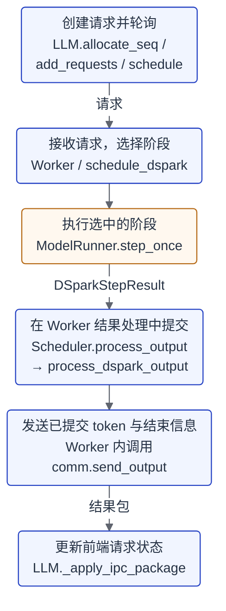
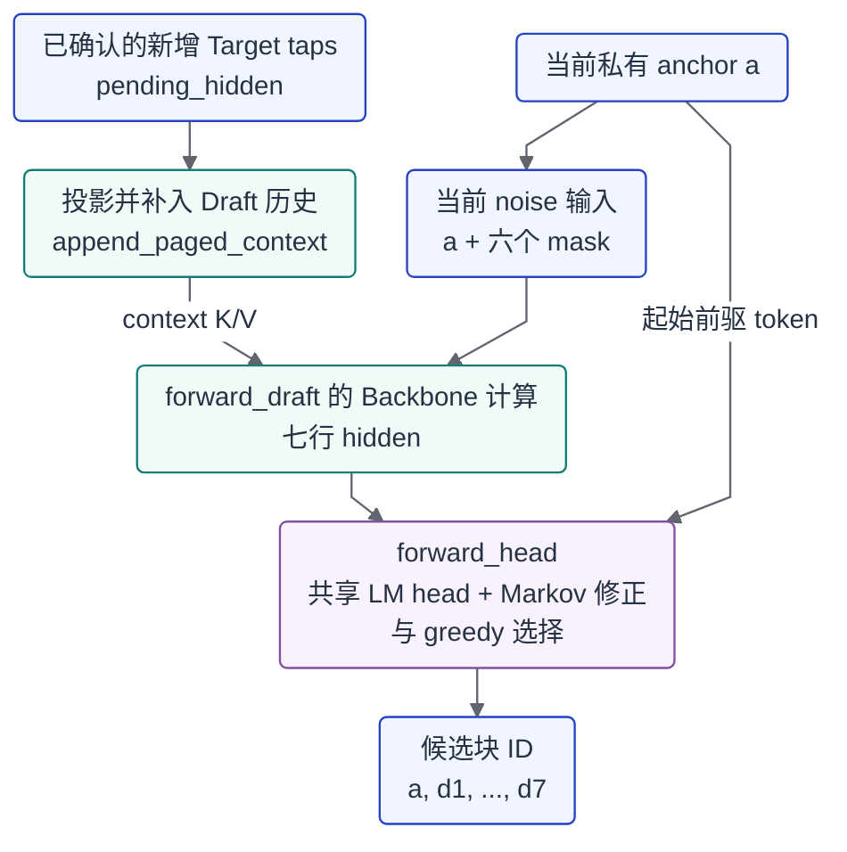
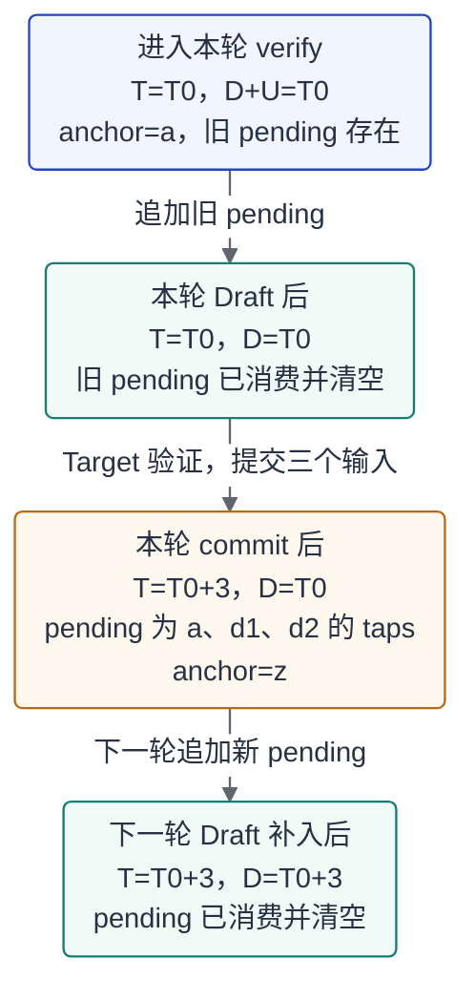

[上一篇](/papers/dspark-source-analysis/)沿着 DeepSpec 的源码，梳理了 DSpark 从准备上下文、生成候选，到验证和更新状态的过程。接下来继续记录将它接入 gLLM 的工作：一个请求怎样使用这些模块，又怎样把验证结果变成正式输出，并带着正确的状态开始下一轮。

这里沿用前两篇对 Target、Draft 和半自回归草稿的介绍，把重点放在它们与现有引擎的衔接上。

## 1. 背景与目标：先接通什么样的 DSpark？

这篇的目标，是让 DSpark 通过 gLLM 已有的请求入口，完成一次能够持续推进、也能够正确结束的生成过程。

理解模型怎样产生候选之后，接入时还要明确几个具体问题：谁给 Draft 提供上下文，谁发起 Target 验证，验证结束后由谁推进请求的正式位置，以及哪些 token 可以返回给调用者。gLLM 的这条执行链把模型计算和正式提交分开，阶段执行返回结果，再由运行时的结果处理逻辑完成 commit。[阶段执行与提交][runtime]

本文固定分析已经合入的 [c93226d16bf62f6e13dd9bfc7ad2d9a526ac1416][baseline]。这个版本包含正常 Engine 的单活动请求接线，可以从请求进入引擎开始追踪；后续新增的 batching 等能力不放进这一版来讲。

### 先明确本篇的运行范围

这条最小路径有明确的配置约束：

| 项目 | 本篇分析的范围 |
| --- | --- |
| 请求 | 纯文本、greedy，repetition_penalty=1，不带 structured output 或 logprobs |
| 并行与调度 | TP=PP=DP=1，单活动请求，maxd=1，关闭 overlap |
| 执行方式 | FA3、eager，关闭 CUDA graphs 和 prefix caching |
| Prompt 处理 | chunked prefill |
| 候选长度 | 固定七个 proposal，加当前 anchor 组成八个 Target 验证输入 |

这些约束来自配置检查、请求检查和实际的候选生成调用。anchor 是启动当前候选块的 token；它在这份实现里的来源和发布时机，会在第三章具体说明。[配置检查][config]、[请求检查][request-guard]、[候选执行入口][draft-call]

第一篇介绍过 DSpark 的置信度调度，但这里的最小路径还没有接入它。模型会计算 confidence，执行端只取候选 ID，没有用返回的分数缩短验证长度。因此，本文讲的是**固定长度的 greedy 最小闭环**。[候选执行入口][draft-call]

源码状态和验证状态也需要分开：上述主线在固定版本中**已经实现、已经合入**；已有的**历史验证**对应合入前快照 `80118bd`。文章基线 `c93226d` 与该快照存在三处 prefix-hash 相关差异，目前收集的材料中尚未取得合入树的直接复测记录。第七章再展开测试覆盖与版本对应；这里不将“已合入”写成“已经重新验证通过”。


## 2. 请求进入 gLLM：复用原有流程，在执行端接入 DSpark

从调用者这一侧看，请求仍然通过 gLLM 的 `LLM` 接口进入。前端负责创建请求、发送请求和收取结果；模型计算发生在 Worker 一侧。理解这个分工，就能找到 DSpark 真正接入的位置。[请求创建][allocate]、[前端轮询][schedule]、[Worker 主循环][worker-loop]

### 从一个请求开始

假设引擎已经按上一节的条件初始化，显式选择了 `speculative_backend="dspark"` 并提供本地 Draft 路径，输入也已经编码成符合上下文长度限制的 `prompt_token_ids`，低层请求接口的使用形态如下：

```python
# 接口用法示意：llm 已初始化，prompt_token_ids 已完成编码。
seq = llm.allocate_seq(
    prompt_token_ids,
    output_len=128,
    temperature=0,
    top_k=1,
    top_p=1.0,
    repetition_penalty=1.0,
    ignore_eos=False,
)
llm.add_requests([seq])

finished = 0
while finished < 1:
    finished += llm.schedule(log=False)

output_token_ids = seq.token_ids[seq.raw_prompt_len:]
```

`allocate_seq` 准备请求对象和输出预算，`add_requests` 将请求放入前端待发送队列；反复调用的 `schedule` 收取返回结果，再发送新请求。在本文使用的同步模式下，前端收取已提交 token 后会更新自己持有的 `seq`，结束时便可以从中取出输出 IDs。[请求创建][allocate]、[请求入队][add]、[前端轮询][schedule]、[前端结果处理][frontend-output]

这里展示的是实际接口的调用顺序，省略了引擎初始化。历史真实权重验证覆盖的也是 `allocate_seq / add_requests / schedule` 这条低层入口。固定版本的 `LLM.generate` 没有提供 `repetition_penalty` 和 `ignore_eos` 的覆盖参数，不能将低层入口的验证结果直接延伸到这个便利方法或 HTTP 服务。[generate 接口][generate]


### 前端轮询和执行端生成各自推进什么？

`LLM.schedule` 每被调用一次，并不等于模型生成了一个 token。它处理的是前端收发；执行端由 Worker 的主循环驱动，Scheduler 选择请求当前需要执行的阶段，Runner 完成计算后，再进入正式提交和结果回传。[前端轮询][schedule]、[Worker 主循环][worker-loop]、[阶段选择][phase-select]

可以先把一个阶段的职责链画出来：



*图 1：一次阶段执行从请求到结果回传的职责关系。图中省略队列和 IPC 实现；请求未结束时，执行端还会继续选择下一阶段。*

其中，`schedule_dspark` 根据请求的 `phase` 选择 prefill、bootstrap、verify 或 tail，并设置本次输入长度；Runner 返回 `DSparkStepResult`，`process_dspark_output` 再调用对应的 commit 函数，把新发布的 token 放入结果包，决定请求继续排队还是结束。[阶段选择与结果处理][runtime]、[Runner 阶段分派][runner-dispatch]

这里先记住一个边界：**执行端拿到模型计算结果后，还要经过 commit，才会向前端发送正式输出。** 前端追加收到的 token，是在更新前端自己的请求记录；它与执行端的状态提交处于不同位置。[阶段执行与提交][runtime]、[前端结果处理][frontend-output]

接下来沿着请求的执行顺序，先看第一次候选生成之前，两个模型和上下文是怎样准备好的。

## 3. 准备首轮生成：加载两个模型，建立上下文与 anchor

请求进入执行端时，需要区分两类准备：模型实例在引擎启动时加载，而每个请求的历史、taps 和 anchor 随着生成阶段逐步建立。[模型初始化][runner-init]、[请求状态建立][request-state]

### Target 先加载，Draft 借用词表模块

`ModelRunner.init` 先加载 Target，再把这个模型实例传给 `load_dspark_draft`。加载器读取 Draft 目录下的 `config.json`，构造 `Qwen38DSpark` 并加载其权重。[模型初始化][runner-init]、[Draft 加载器][loader]

Draft 拥有自己的 Backbone、投影、归一化、Markov Head 和 Confidence Head；embedding 与 LM head 则持有 Target 对应模块的引用。于是，输入 token 的嵌入和输出词表映射沿用 Target 的模块，Draft 的候选计算使用自己的参数。[Draft 构造][draft-init]

这个加载过程还会检查双方是否匹配，包括 hidden size、vocab size、taps 层号，以及固定的 `block_size=7`。加载器要求借用的 embedding/head 位于同一 CUDA 设备且为 BF16，Draft 参数也为同设备 BF16。这些检查针对具体模块和状态，不能据此将整个 Target 的权重精度统称为 BF16。[Draft 加载器][loader]

> **[待核实]** 历史运行所用 Target/Draft 的可公开远端 revision，以及当时完整的 checkpoint 配置正文尚未补齐。这里按源码说明加载契约，不代入未经确认的 hidden size、层数或 Markov rank。


### Prefill 同时为 Target 和 Draft 建立上下文

有了模型以后，请求开始处理 prompt。本文用 P 表示 prompt 的 token 数，后续的 y0、y1 都是解释流程的符号，不代表某次运行的真实 token。

在 prefill 阶段，`_execute_dspark_prompt` 对当前 prompt chunk 调用 Target 的 `forward_with_hidden_taps`。这次调用返回两类数据：最终归一化后的 hidden，用于生成预测；以及指定 decoder block 的 taps，用来给 Draft 提供上下文。[Prompt 执行][prompt-execute]、[Target taps 接口][target-taps]

这里的 taps 取自指定 block 的完整 residual stream，并按配置指定的顺序组织；它们与最终 post-norm hidden 分别保存。接入时需要取对这一路特征，而不能只看变量名或形状相似就混用。[Target taps 接口][target-taps]

对于 prompt 的每个 chunk，这些 taps 都会传给 `Draft.prefill_paged`，建立或追加 Draft 自己的 context。中间 chunk 不发布回答 token；到最后一个 chunk，Target 才从末位置的 hidden 选出首个回答 token y0。[Prompt 执行][prompt-execute]、[Draft context 追加][draft-context]

随后，`commit_dspark_prompt_step` 推进正式的 Target 处理进度，并将 y0 追加到正式 token 历史中。这一步只发布一次 y0。[Prompt 提交][prompt-commit]

### Bootstrap：消费已经发布的 y0，准备下一预测 y1

最后一次 prefill 结束后，Target 已经处理完 P 个 prompt token，并预测、发布了 y0。但 y0 此时还没有在自己的位置作为 Target 输入执行，因此还没有这个输入位置对应的 Target KV 和 taps。[Prompt 执行][prompt-execute]、[Prompt 提交][prompt-commit]

这个版本接着安排一个单 token 的 bootstrap：让 Target 消费 y0，取得 y0 对应的 taps，同时预测后面的 y1。提交 bootstrap 结果时，代码将这行 taps 存入 `state.pending_hidden`，把 y1 存入 `state.anchor`，并切换到 verify 阶段；它不会再次向输出追加 y0。[Prompt 执行][prompt-execute]、[Prompt 提交][prompt-commit]

因此，第一次 verify 准备使用的 anchor 是**尚未发布的 y1**。此时 Target 已经消费到 y0，Draft 的有效 context 仍然覆盖 prompt；y0 的 taps 暂存在 pending 中，等待接下来的 Draft forward 补入。[Prompt 提交][prompt-commit]、[Draft 调用边界][draft-call]

把启动过程放在一起，可以看到这几个时机的区别：

| 阶段 | Target 这一步消费什么 | 本次新发布什么 | 留给后续执行的数据 |
| --- | --- | --- | --- |
| 中间 prefill chunk | 当前一段 prompt | 无 | 该 chunk 的 taps 已追加到 Draft context |
| 最后 prefill chunk | 剩余 prompt，至此处理完 P 个输入 | y0 | Draft 已有全部 prompt 的 context；y0 尚未作为 Target 输入 |
| Bootstrap | 已经发布的 y0 | 无 | pending 保存 y0 的 taps；私有 anchor 为下一预测 y1 |

*表中描述对应步骤提交后的状态，假设首 token 没有触发结束。依据固定源码整理，不是实测 trace。*

如果 y0 已经满足 EOS 或输出预算条件，请求会结束，不再执行 bootstrap。对于继续生成的请求，上面的启动步骤已经备齐第一次 Draft 调用的两类输入：**待补入历史的 y0 taps，以及启动当前候选块的私有 anchor y1。**[运行时提交与结束判断][runtime]、[Prompt 提交][prompt-commit]、[完成条件][finish]

## 4. Draft 提候选：补入新特征，再生成七个 proposal

Bootstrap 已经留下 y0 的 taps 和私有 anchor y1。接下来的问题是：怎样让 Draft 利用这些数据，提出当前一轮的候选？

从这里开始，用 a 统称当前私有 anchor；第一次进入候选生成时，a 就是上一章的 y1。执行入口从请求状态中取出 pending 和 anchor，先调用 Backbone，再调用 head：

```python
draft_hidden, _ = self.dspark.forward_draft(
    pending, state.anchor, start_pos=start, caches=state.paged_cache
)
state.pending_hidden = None
proposed, _, _ = self.dspark.forward_head(draft_hidden, state.anchor)
```

这几行节选自 `_execute_dspark_verify`。其中 `pending` 来自 `state.pending_hidden`，`start` 是本轮开始时的 `seq.computed_token_num`；它们分别说明“还有哪些已确认特征需要补入”和“当前候选块从哪里开始”。[Draft 调用边界][draft-call]

### 两路输入：新增上下文与当前 token 块

pending 保存的是 Target 已经处理、但还没有加入 Draft 历史的 taps。Draft 先投影这些新增特征，再由各层自己的 K/V 投影追加到 context；此前已经建立的历史继续从 Draft cache 读取。[Draft context 追加][draft-context]

另一条输入从 anchor 出发，组织为：

```text
[a, mask, mask, mask, mask, mask, mask]
```

这七个位置经共享 embedding 和 Draft Backbone，得到七行 hidden。当前块的 attention 会读取历史 context 和本块临时 K/V；这些 noise 位置不会在这一步写成可复用的 Draft 历史。[Noise 输入构造][draft-init]、[Draft Backbone][draft-forward]、[Draft attention][draft-attention]



*图 2：Draft 的两路输入与候选出口。历史来自 Target taps，当前块由 anchor 和 mask 构成；head 另外使用 anchor 作为第一个前驱 token。*

这里有一个容易因变量名看错的返回值：`forward_draft` 返回的第二项 `draft_ids` 仍然是 anchor 加 mask 的输入块。真正的候选 ID 来自后面的 `forward_head`；调用方用 `_` 丢弃前一个返回值。[Draft Backbone 返回值][draft-forward]、[Head 返回值][draft-head]

### 从七行 hidden 到八个验证输入

`forward_head` 先通过共享 LM head 取得七个位置的 logits，再逐位置加入 Markov 修正。第一个位置以前驱 a 为条件，选出 d1；下一位置使用实际选出的 d1，依次得到 d2 到 d7。当前调用没有传 sampling 回调，使用默认 argmax，整个逐位置循环都在 head 内完成。[Head 实现][draft-head]

首行虽然输入了 a，它的 hidden 负责预测的是 d1。a 本身会被单独放在输出第零项，因此，**七行 hidden 产生七个 proposal，交给 Target 的 ID 块共有八项**：

`[a, d1, d2, d3, d4, d5, d6, d7]`。[Head 的位置对齐][draft-head]

若用 L 表示 taps 层数、H 表示配置中的 hidden size、U 表示本轮新增 taps 行数，关键交接形状是 `pending_hidden: [1,U,L*H]`、`draft_hidden: [1,7,H]`、`proposed: [1,8]`。这里的维度关系来自源码构造，尚未代入历史 checkpoint 的具体尺寸。[上下文投影][draft-init]、[Draft context 追加][draft-context]、[Backbone 与 head][draft-forward]

执行端随后只取 `proposed`，转为临时验证输入。head 返回的 logits 和 confidence 都被忽略；这条路径没有按 confidence 截断。Target 接收到的是候选 ID 及其 input_data，仍要自己计算验证结果。[验证输入交接][verify-execute]

## 5. Target 验证与提交：哪些 token 真正成为输出？

候选已经准备好，但它们还没有进入请求的正式 token 历史。执行端先把八个 ID 放入 `seq.to_compute_tokens`，设置八行 query，再准备位置和 attention metadata；调用完成后恢复这些临时输入标记。[验证输入交接][verify-execute]

设本轮开始时 Target 的正式进度为 T，八个输入位于 T 到 T+7。Target 沿已有 KV 和 recurrent state 计算这段输入，返回最终 hidden 和 taps。verifier 再逐行调用 LM head 并取 argmax：这一版实际是一次八行 Target body、八次单行 head 调用。[Target 验证][target-verify]

### 比较的是下一位置的候选

每行预测对应其输入之后的 token。因此，第零行的预测与 d1 比较，第一行的预测与 d2 比较，最后一行的预测则留作整块之后的可能接续。源码中的连续接受计算很短：

```python
matches = predictions[:-1] == tokens[1:]
accepted = int(matches.to(torch.int32).cumprod(dim=0).sum().item())
length = 1 + accepted
```

`accepted` 记为 n，只统计 proposal。anchor a 由此前的 Target 预测提供，不在这七项比较里；待提交输入前缀的长度为 1+n。[连续前缀计算][target-verify]

下面沿用一个符号例子：假设 a、d1、d2 都不是 EOS，输出预算足够继续，并且 z≠d3：

```text
验证输入     [a,  d1, d2, d3, d4, d5, d6, d7]
Target 预测  [d1, d2, z,  d4, d5, d6, d7, w ]
匹配结果     [1,  1,  0,  1,  1,  1,  1 ]
```

这是依据代码构造的演算，不是真实模型输出。d3 首次不匹配后，后面的局部匹配也不能继续接受；cumprod 得到的连续前缀只有 d1、d2，故 n=2。[接受规则][target-verify]

verifier 此时返回三项后续所需的数据：

| 返回字段 | 这个例子中的内容 |
| --- | --- |
| `committed_ids` | 待提交输入 `[[a,d1,d2]]`，保留单请求 batch 维 |
| `accepted_hidden` | 对应 a、d1、d2 的三行 Target taps |
| `next_anchor` | 下一预测 `[z]` |

这些字段保存在验证结果里，此时尚未追加正式 token 或推进正式 Target 进度。[验证结果构造][target-verify]

### Commit 决定正式发布什么

运行时处理阶段结果时，调用 `commit_dspark_verify_step`。它根据可接受前缀、EOS 和剩余预算决定实际保留的输入数 r，先提交相应 Target 状态，再追加正式 token、推进 `computed_token_num`。对于上面没有触发结束的例子，r=1+n=3，新发布的就是 `[a,d1,d2]`。[Verify 提交][verify-commit]

z 会存入请求的 `state.anchor`，留到下一次 verify 或 tail 作为输入消费后发布。即使七个 proposal 全被接受，最后一行预测也仍然作为下一 anchor 保存，不在本次 commit 里额外追加。[Verify 提交][verify-commit]、[Tail 提交][tail-commit]

因此，这份实现需要分别数清“接受了几个 proposal”“提交了几个输入”和“下一步预测是什么”。它使用 greedy 前缀比较，没有概率拒绝采样或残差分布重采样；不能直接把参考实现里的一次输出动作套到这里。[Target 验证][target-verify]

提交入口还检查结果对应的请求、cache epoch、起始位置和 inflight 归属，并在成功后标记 consumed，拒绝同一结果再次提交。运行时随后把新发布的 token 装入结果包，前端才更新自己的输出历史。[结果归属检查][result-validation]、[Verify 提交][verify-commit]、[结果回传][runtime]

## 6. 继续与结束：把正确的状态带到下一轮

前一章确定了本轮输出，下一轮还需要沿着这些输入留下的历史继续。这里需要保留的既有正式 token，也有 Target 进度、Draft 历史、pending taps 和私有 anchor；它们的更新时间并不完全相同。[请求状态][state-fields]、[Verify 提交][verify-commit]

### 两份 cache，分别沿各自的历史继续

这个基线已经使用 paged Draft cache，并将两侧 cache 注册到共同的 arena 中。理解最小闭环，只需先分清各自保存什么：

| 项目 | Target | Draft |
| --- | --- | --- |
| 请求页表 | `seq.page_table` | `state.cache.page_table` |
| 保存的历史 | Full-attention K/V；另有 GDN recurrent state | 已确认 Target taps 经 Draft 自身投影形成的 context K/V |
| 本文使用的有效进度 | `seq.computed_token_num` | `state.cache.context_length` |

两侧分别注册、分配和管理自己的 cache；共同的 arena 不表示共享 K/V 值，也不表示两张页表能够互用。这里不展开物理页分配与完整显存管理。[两侧 cache 初始化][cache-init]、[联合预留][cache-reserve]、[Draft context 追加][draft-context]

### Pending taps 连接 Target 与 Draft 的进度

用三个记号描述进入 verify 前的状态：

- T = `seq.computed_token_num`：Target 已正式消费的输入数。
- D = `state.cache.context_length`：Draft 有效 context 长度。
- U = `state.pending_hidden.shape[1]`：尚待补入 Draft 的 taps 行数。

execution 在启动这一轮时明确检查 `D+U=T`。Draft 把旧 pending 追加后，D 到达 T；随后当前候选才进入 Target 验证。本轮接受输入的 taps，要等 commit 后成为新的 pending，供下一次 Draft 消费。[Verify 入口检查][draft-call]、[Draft context 追加][draft-context]、[Verify 提交][verify-commit]

继续使用 n=2、r=3 的例子，记本轮起点为 T0：



*图 3：部分接受后的状态交接。时点和数值是固定源码的符号演算，假设请求继续且下一轮仍使用 Draft；不是运行 trace。*

commit 后 Target 正式进度已经到 T0+3，Draft 仍停在 T0；中间这三行差额由 pending 准确记录。只有接受输入前缀的 taps 才会成为新 pending，被拒绝的 d3…d7 不会因此进入 Draft 的有效历史。当前 noise 的临时 K/V 也不会被保留为历史。[验证结果][target-verify]、[Verify 提交][verify-commit]、[Draft attention][draft-attention]

### Target 写过的后缀，怎样与有效历史区分？

Target 验证计算了整块输入，所以缓存中可能已经写入后来没有提交的位置。这个路径没有按拒绝 token 数逐个释放物理 slot，也没有在每轮 commit 后裁掉页表；正式进度仍只推进 r 个输入。[Target 验证][target-verify]、[Verify 提交][verify-commit]、[联合预留][cache-reserve]

下一轮从新的 `computed_token_num` 准备位置、序列长度和写入映射。本例起点是 T0+3，后续输入会从这里重新写入；页里残留的旧后缀字节，不能仅因曾被计算就成为已确认历史。预留容量、已发生的写入和允许继续使用的前缀，需要分别看。[位置与长度构造][input-progress]、[写入映射][slot-mapping]

本文解释到这层提交和 metadata 协议。**[待核实]** 外部 attention kernel 的完整写入/因果读取契约尚未逐项审计，不能由上述调用关系宣称所有缓存行为都已证明。

对这个 hybrid Target，还必须处理 GDN 的 conv/temporal 状态。八行验证会留下各输入后的检查点，实际保留 r 个输入时，`commit_dspark_verify_state` 选择第 r−1 列：本例 r=3，选择消费 d2 后的第 2 列。代码通过交换 CPU 状态槽 ID 更新 rolling slot，下一轮再重新构造并复制对应 metadata。[GDN 状态提交][gdn-commit]、[GDN metadata 重建][gdn-metadata]、[Metadata 上传][metadata-copy]

这也是只推进 token 数量还不够的原因：下一轮需要同时对应正确的输入位置、attention 历史和 recurrent state。[GDN 状态提交][gdn-commit]、[位置与长度构造][input-progress]

### 窗口不足时，转为只用 Target 的 tail

每轮调度会检查完整验证窗口是否还放得下，包括剩余输出预算、Target 上下文和 Draft 位置范围。放不下时 phase 切到 tail，每步只消费一个私有 anchor；缓存预留失败则走请求失败处理，不等同于这个窗口检查分支。[窗口检查][verify-fits]、[阶段选择][phase-select]

tail 不再运行 Draft，也不收集新的 taps。它让 Target 消费当前 anchor、预测下一个 token；commit 发布刚消费的输入，将新预测留作下一次 anchor。Draft 历史停止增长，pending 被清空，所以前面的 `D+U=T` 只适用于 verify 准备阶段，不能套到 tail 上。[Tail 执行][tail-execute]、[Tail 提交][tail-commit]

结束仍以正式输出为准：达到输出预算，或未忽略 EOS 时正式末 token 是结束 token，才满足完成条件。verify commit 会保留到前缀中的第一个 EOS，并按实际 r 选择状态；结束后清空 pending 和 anchor。私有 anchor 即使已经预测为 EOS，也要等它被消费并发布，才触发对应的完成判断。[完成条件][finish]、[Verify 提交][verify-commit]、[Tail 提交][tail-commit]

正常调度要求预算足够容纳八输入才启动 verify；commit 内的预算截取还提供一层保护，这不属于动态缩短 proposal 长度。[窗口检查][verify-fits]、[Verify 提交][verify-commit]

请求结束后，运行时进入退休和释放路径：等待最后一次 GPU 使用边界，再释放 Draft、Target 及 recurrent 资源并移除请求记录。本文只说明正常结束所需的顺序，完整取消、抢占和故障恢复留在后续集成主题中。[正常结果处理][runtime]、[请求释放][request-free]、[两侧 cache 释放][cache-free]

## 7. 如何确认跑通：正确性证据与版本对应

前面的调用链说明代码怎样执行。确认集成结果，还需要看实际用了哪份源码、从哪个入口运行，以及返回的 token 是否与对照一致。

这里整理的是 2026-10-27、28 日已有的历史验证记录，本次撰稿没有重新运行模型或测试。文章讲解固定在 `c93226d`；正常 Engine 低层入口和相关回归的已测快照则是 [80118bd][tested-engine]，内部执行核心还有一份更早的 [08cc83b][tested-core] 记录。下面的结果分别归属这些快照。[^validation-records]

### 组件对照、内部生成与正常入口各自证明什么？

| 验证层次 | 已测快照 | 历史结果 | 覆盖到哪里 |
| --- | --- | --- | --- |
| 相关组件与集成回归 | `80118bd` | 458 passed，JUnit 无 failure/error/skip | 配置、Draft、Verify、状态和运行时相关断言；不等于全仓测试或真实权重生成 |
| 真实权重内部驱动 | `08cc83b` | 15/15 输出 IDs 与停止原因一致，并保存实际 verify 轮记录 | 模型加载和内部执行/commit 闭环；没有覆盖正常 LLM 构造及 Worker 启动 |
| 真实权重正常 Engine 低层入口 | `80118bd` | 15/15 完整输出 IDs 与停止原因一致 | LLM 构造、spawn、Worker/Runner 初始化、allocate/add/schedule 到 IPC 输出 |

配置测试的 49 passed、定向测试的 43 passed 都是 458 的子集，不能相加。测试源码中的 [内部多轮对照][execution-test]、[Worker/Scheduler 集成对照][runtime-test] 确实运行模型模块，但对应 fixture 使用小模型和合成权重；这部分证据要与真正加载 checkpoint 的生成验证分开。[Fixture 构造][tiny-fixture]

正常低层入口的真实权重验证使用 NVIDIA A100 80GB PCIe，Target 为 `Qwen3.8-27B-FP8`，Draft 为 `Qwen3.8-27B-DSpark` 并按 BF16 加载。运行条件是 TP=PP=DP=1、FA3 eager、maxd=1，activation/KV/conv 为 BF16，temporal state 为 FP32；请求采用 greedy，repetition_penalty=1。[^validation-records]

15 组对照包含 8 组自然 EOS 和 7 组预算边界，后者的输出预算分别为 1、2、7、8、9、64、128，并设置 ignore_eos。比如 `en_short-b128` 中，两条路径均输出 `[57590,248046]`，脚本判定停止原因为 eos。这是历史报告中的真实数组，与前面的 a、d1、z 符号例子不同。[^validation-records]

这里的 stop reason 是验证脚本根据输出末 token、EOS 设置和预算派生的 `eos/output_budget` 标签，并非 HTTP 协议的 finish_reason。15/15 表示完整请求的输出对照数，也不代表每个请求都执行了 Draft 验证：短预算请求可以在首 token 或 tail 阶段结束。

内部驱动补充了真实候选计算的证据，其归档包含 191 轮 verify，覆盖接受前缀与后续提交的记录。但它与正常低层入口使用不同快照和驱动，不能把内部统计写成公开入口的接受率，也不能将两套 15/15 合并成 30 个独立输入。[^validation-records]

### 历史已测快照与文章基线仍有区别

源码哈希对照确认，组件记录中的 573 个 Git 跟踪文件全部匹配 `80118bd`，正常入口归档也保存了这一份源文件树，没有混入后续 batching 代码。

这份快照与文章基线 `c93226d` 相比，有三处 prefix-hash 相关差异：`python/runtime/memory_manager.py` 以及两个 prefix-cache 测试文件。DSpark 的主要执行、验证和接线文件相同，但仍不能据此将旧日志写成合入树的新测试结果。[两个版本的差异][tested-to-baseline]

> **[待核实]** 当前材料中没有 `c93226d` 合入树的直接复测记录。已有证据支持指定历史快照、模型配置和样例下的输出一致，不构成所有输入、模型精度或后端上的普遍等价证明。


### 仍需保留的验证缺口

模型名称与部分元数据指纹已经记录，但可公开定位的远端 revision、历史配置正文和完整权重内容身份仍是 **[待核实]**。本文也没有拿小模型 fixture 的配置替代这些材料。

正常入口记录中还有一个退出时的 semaphore cleanup warning：所有请求完成后，验证脚本主动终止其启动的 Worker，随后出现 `resource_tracker` 提示。它不能单独确认请求级资源泄漏，也不能作为优雅停服已经验证的证据；这部分清理行为仍需专门检查。

完整 GitHub Checks/Actions 的通过记录同样 **[待核实]**。现有依据是用户历史执行保留的日志、JUnit 和结果报告；已有的有限 CI 查询没有提供完整 CI 通过证明。HTTP、`LLM.generate`、长期运行及完整失败生命周期，也没有被这次低层入口对照覆盖。

这些记录回答的是指定条件下的正确性问题。这里没有时延、吞吐或端到端加速对照，不能由 token 对齐、接受长度或测试通过数推导性能收益。[^validation-records]

## 8. 最小实现的能力边界与后续方向

读到这里，可以把本文的成果限定为：gLLM 中已经形成一条固定长度 greedy 的 DSpark 执行主线，并有特定历史快照下的正确性证据。源码状态与验证状态分别看，才能判断还有哪些工作需要继续：

| 状态 | 本篇能够说明的内容 |
| --- | --- |
| 已实现 | 正常低层请求接线、Target taps、真实 Draft proposal、greedy verify、正式 commit、状态延续与 tail/结束处理 |
| 已合入 | 上述主线属于文章固定的 `c93226d` 版本 |
| 已验证 | `80118bd`、`08cc83b` 各自记录范围内的组件断言和真实权重对照；不是任意版本的通用结论 |
| 尚未完成（本文基线） | runtime 的 confidence 截断/STS 动态调度，以及通用随机采样验证；模型返回 confidence 不等于这些能力已经接通 |
| 尚未验证 | **[待核实]** 合入树直接复测、完整 CI、更多配置、长时稳定性、完整服务生命周期及性能 |
| 不在本篇展开 | 多活动请求 batching、多 GPU、完整 HTTP、Abort/Preempt、分配器优化，以及 vLLM/SGLang 对比 |

配置检查和单请求阶段选择限定了这个版本的使用范围；这些限制针对 DSpark 路径，不代表 gLLM 的其他后端也缺少相应能力。[配置约束][config]、[请求约束][request-guard]、[单请求阶段选择][phase-select]

后续的集成记录可以继续围绕三类问题展开：

1. **从单请求走向服务运行。** 请求共存、调度、取消和抢占怎样影响 Draft/Target 的状态与资源归属。
2. **补齐正确性证据与能力范围。** 固定待测版本、模型 revision 和原始输入，再检查更多边界，以及新增采样或调度能力后的对照结果。
3. **在正确性之外测量性能。** 另行记录环境、基线、计时方法和运行条件，再讨论具体优化是否带来收益。

这些是后续文章和实验的问题清单。本文先把模型接口、结果提交与跨轮状态的关系固定下来，后续改变其中一环时，就有一份可以回查的执行地图。

[^validation-records]: 历史证据来自本地保留的三份归档：2026-10-28 的 `pr2-6c-user-r2-reports.tar.gz`（JUnit 与测试日志）、`pr2-6c-entry-user-r3-reports.tar.gz`（两模式完整输出、入口日志与源码 manifest），以及 2026-10-27 的 `pr326-row-head-fix-user-r1-reports.tar.gz`（内部真实权重逐轮报告）。原始日志未随本文公开上传；结果按各自已测快照引用，不代表本次重跑。

[baseline]: https://github.com/gty111/gLLM/commit/c93226d16bf62f6e13dd9bfc7ad2d9a526ac1416 "文章源码基线；00_scope.md §2"
[config]: https://github.com/gty111/gLLM/blob/c93226d16bf62f6e13dd9bfc7ad2d9a526ac1416/python/runtime/config.py#L79-L118 "EngineConfig.__post_init__，python/runtime/config.py:79–118"
[request-guard]: https://github.com/gty111/gLLM/blob/c93226d16bf62f6e13dd9bfc7ad2d9a526ac1416/python/speculative/dspark_execution.py#L18-L37 "DSparkExecutionMixin._validate_dspark_request，python/speculative/dspark_execution.py:18–37"
[draft-call]: https://github.com/gty111/gLLM/blob/c93226d16bf62f6e13dd9bfc7ad2d9a526ac1416/python/speculative/dspark_execution.py#L135-L162 "DSparkExecutionMixin._execute_dspark_verify，python/speculative/dspark_execution.py:135–162"
[allocate]: https://github.com/gty111/gLLM/blob/c93226d16bf62f6e13dd9bfc7ad2d9a526ac1416/python/engine/llm.py#L602-L666 "LLM.allocate_seq，python/engine/llm.py:602–666"
[add]: https://github.com/gty111/gLLM/blob/c93226d16bf62f6e13dd9bfc7ad2d9a526ac1416/python/engine/llm.py#L387-L389 "LLM.add_requests，python/engine/llm.py:387–389"
[schedule]: https://github.com/gty111/gLLM/blob/c93226d16bf62f6e13dd9bfc7ad2d9a526ac1416/python/engine/llm.py#L515-L592 "LLM.send_ipc_package / schedule，python/engine/llm.py:515–592"
[worker-loop]: https://github.com/gty111/gLLM/blob/c93226d16bf62f6e13dd9bfc7ad2d9a526ac1416/python/workers/worker.py#L999-L1007 "Worker.run_pp0，python/workers/worker.py:999–1007"
[frontend-output]: https://github.com/gty111/gLLM/blob/c93226d16bf62f6e13dd9bfc7ad2d9a526ac1416/python/engine/llm.py#L459-L513 "LLM._apply_ipc_package，python/engine/llm.py:459–513"
[generate]: https://github.com/gty111/gLLM/blob/c93226d16bf62f6e13dd9bfc7ad2d9a526ac1416/python/engine/llm.py#L672-L721 "LLM.generate，python/engine/llm.py:672–721"
[phase-select]: https://github.com/gty111/gLLM/blob/c93226d16bf62f6e13dd9bfc7ad2d9a526ac1416/python/speculative/dspark_runtime.py#L19-L76 "schedule_dspark，python/speculative/dspark_runtime.py:19–76"
[runtime]: https://github.com/gty111/gLLM/blob/c93226d16bf62f6e13dd9bfc7ad2d9a526ac1416/python/speculative/dspark_runtime.py#L79-L132 "process_dspark_output / schedule_forward_dspark，python/speculative/dspark_runtime.py:79–132"
[runner-dispatch]: https://github.com/gty111/gLLM/blob/c93226d16bf62f6e13dd9bfc7ad2d9a526ac1416/python/runtime/model_runner.py#L1269-L1292 "ModelRunner._step_dspark_* / step_once，python/runtime/model_runner.py:1269–1292"
[runner-init]: https://github.com/gty111/gLLM/blob/c93226d16bf62f6e13dd9bfc7ad2d9a526ac1416/python/runtime/model_runner.py#L577-L590 "ModelRunner.init，python/runtime/model_runner.py:577–590"
[request-state]: https://github.com/gty111/gLLM/blob/c93226d16bf62f6e13dd9bfc7ad2d9a526ac1416/python/speculative/dspark_execution.py#L39-L58 "DSparkExecutionMixin._get_dspark_request，python/speculative/dspark_execution.py:39–58"
[loader]: https://github.com/gty111/gLLM/blob/c93226d16bf62f6e13dd9bfc7ad2d9a526ac1416/python/runtime/model_loader.py#L188-L246 "load_dspark_draft，python/runtime/model_loader.py:188–246"
[draft-init]: https://github.com/gty111/gLLM/blob/c93226d16bf62f6e13dd9bfc7ad2d9a526ac1416/python/models/qwen38_dspark.py#L445-L496 "Qwen38DSpark.__init__ / _project_context / _embed_noise，python/models/qwen38_dspark.py:445–496"
[prompt-execute]: https://github.com/gty111/gLLM/blob/c93226d16bf62f6e13dd9bfc7ad2d9a526ac1416/python/speculative/dspark_execution.py#L69-L132 "DSparkExecutionMixin._execute_dspark_prompt，python/speculative/dspark_execution.py:69–132"
[target-taps]: https://github.com/gty111/gLLM/blob/c93226d16bf62f6e13dd9bfc7ad2d9a526ac1416/python/models/qwen3_5.py#L1244-L1353 "Qwen3_5Model.forward_with_hidden_taps / _forward，python/models/qwen3_5.py:1244–1353"
[draft-context]: https://github.com/gty111/gLLM/blob/c93226d16bf62f6e13dd9bfc7ad2d9a526ac1416/python/models/qwen38_dspark.py#L519-L610 "Qwen38DSpark.prefill_paged / append_paged_context，python/models/qwen38_dspark.py:519–610"
[prompt-commit]: https://github.com/gty111/gLLM/blob/c93226d16bf62f6e13dd9bfc7ad2d9a526ac1416/python/speculative/dspark.py#L76-L127 "commit_dspark_prompt_step，python/speculative/dspark.py:76–127"
[finish]: https://github.com/gty111/gLLM/blob/c93226d16bf62f6e13dd9bfc7ad2d9a526ac1416/python/runtime/sequence.py#L196-L201 "GenerationSequence.is_finish，python/runtime/sequence.py:196–201"
[draft-forward]: https://github.com/gty111/gLLM/blob/c93226d16bf62f6e13dd9bfc7ad2d9a526ac1416/python/models/qwen38_dspark.py#L612-L704 "Qwen38DSpark.forward_draft，python/models/qwen38_dspark.py:612–704"
[draft-head]: https://github.com/gty111/gLLM/blob/c93226d16bf62f6e13dd9bfc7ad2d9a526ac1416/python/models/qwen38_dspark.py#L706-L741 "Qwen38DSpark.forward_head，python/models/qwen38_dspark.py:706–741"
[draft-attention]: https://github.com/gty111/gLLM/blob/c93226d16bf62f6e13dd9bfc7ad2d9a526ac1416/python/models/qwen38_dspark.py#L300-L344 "Qwen38DSparkAttention.forward，python/models/qwen38_dspark.py:300–344"
[verify-execute]: https://github.com/gty111/gLLM/blob/c93226d16bf62f6e13dd9bfc7ad2d9a526ac1416/python/speculative/dspark_execution.py#L135-L187 "DSparkExecutionMixin._execute_dspark_verify，python/speculative/dspark_execution.py:135–187"
[target-verify]: https://github.com/gty111/gLLM/blob/c93226d16bf62f6e13dd9bfc7ad2d9a526ac1416/python/speculative/dspark.py#L287-L327 "verify_dspark_target，python/speculative/dspark.py:287–327"
[verify-commit]: https://github.com/gty111/gLLM/blob/c93226d16bf62f6e13dd9bfc7ad2d9a526ac1416/python/speculative/dspark.py#L377-L420 "commit_dspark_verify_step，python/speculative/dspark.py:377–420"
[result-validation]: https://github.com/gty111/gLLM/blob/c93226d16bf62f6e13dd9bfc7ad2d9a526ac1416/python/speculative/dspark.py#L62-L73 "_validate_dspark_step_result，python/speculative/dspark.py:62–73"
[state-fields]: https://github.com/gty111/gLLM/blob/c93226d16bf62f6e13dd9bfc7ad2d9a526ac1416/python/speculative/dspark.py#L20-L59 "DSparkStepResult / DSparkRequestState，python/speculative/dspark.py:20–59"
[cache-init]: https://github.com/gty111/gLLM/blob/c93226d16bf62f6e13dd9bfc7ad2d9a526ac1416/python/runtime/memory_manager.py#L1157-L1218 "MemoryManager.init，python/runtime/memory_manager.py:1157–1218"
[cache-reserve]: https://github.com/gty111/gLLM/blob/c93226d16bf62f6e13dd9bfc7ad2d9a526ac1416/python/runtime/memory_manager.py#L1656-L1704 "MemoryManager.reserve_dspark_pages，python/runtime/memory_manager.py:1656–1704"
[input-progress]: https://github.com/gty111/gLLM/blob/c93226d16bf62f6e13dd9bfc7ad2d9a526ac1416/python/runtime/input_data.py#L744-L808 "InputData._cal_tokens / _cal_position / _cal_seq_lens，python/runtime/input_data.py:744–808"
[slot-mapping]: https://github.com/gty111/gLLM/blob/c93226d16bf62f6e13dd9bfc7ad2d9a526ac1416/python/runtime/input_data.py#L909-L980 "InputData._cal_block_table / _cal_slot_mapping，python/runtime/input_data.py:909–980"
[gdn-commit]: https://github.com/gty111/gLLM/blob/c93226d16bf62f6e13dd9bfc7ad2d9a526ac1416/python/speculative/dspark.py#L330-L374 "commit_dspark_verify_state，python/speculative/dspark.py:330–374"
[gdn-metadata]: https://github.com/gty111/gLLM/blob/c93226d16bf62f6e13dd9bfc7ad2d9a526ac1416/python/runtime/input_data.py#L360-L387 "InputData._cal_ssm_metadata，python/runtime/input_data.py:360–387"
[metadata-copy]: https://github.com/gty111/gLLM/blob/c93226d16bf62f6e13dd9bfc7ad2d9a526ac1416/python/runtime/input_data.py#L433-L458 "InputData.copy_to_input_buffer，python/runtime/input_data.py:433–458"
[verify-fits]: https://github.com/gty111/gLLM/blob/c93226d16bf62f6e13dd9bfc7ad2d9a526ac1416/python/speculative/dspark_execution.py#L60-L66 "DSparkExecutionMixin._dspark_verify_fits，python/speculative/dspark_execution.py:60–66"
[tail-execute]: https://github.com/gty111/gLLM/blob/c93226d16bf62f6e13dd9bfc7ad2d9a526ac1416/python/speculative/dspark_execution.py#L190-L224 "DSparkExecutionMixin._execute_dspark_tail，python/speculative/dspark_execution.py:190–224"
[tail-commit]: https://github.com/gty111/gLLM/blob/c93226d16bf62f6e13dd9bfc7ad2d9a526ac1416/python/speculative/dspark.py#L423-L449 "commit_dspark_tail_step，python/speculative/dspark.py:423–449"
[request-free]: https://github.com/gty111/gLLM/blob/c93226d16bf62f6e13dd9bfc7ad2d9a526ac1416/python/speculative/dspark_execution.py#L244-L269 "DSparkExecutionMixin._free_dspark_request，python/speculative/dspark_execution.py:244–269"
[cache-free]: https://github.com/gty111/gLLM/blob/c93226d16bf62f6e13dd9bfc7ad2d9a526ac1416/python/runtime/memory_manager.py#L1712-L1729 "MemoryManager.free_dspark_cache / free，python/runtime/memory_manager.py:1712–1729"
[tested-engine]: https://github.com/gty111/gLLM/commit/80118bd0a89af6cd4aa8bf98596e5f953b4bba65 "正常入口历史已测快照；05_validation.md §2"
[tested-core]: https://github.com/gty111/gLLM/commit/08cc83bce84b225668b551fc8adc82f1cf285308 "内部执行核心历史已测快照；05_validation.md §2"
[tested-to-baseline]: https://github.com/gty111/gLLM/compare/80118bd0a89af6cd4aa8bf98596e5f953b4bba65...c93226d16bf62f6e13dd9bfc7ad2d9a526ac1416 "已测快照到文章基线差异；05_validation.md §2.3"
[execution-test]: https://github.com/gty111/gLLM/blob/c93226d16bf62f6e13dd9bfc7ad2d9a526ac1416/tests/test_qwen38_dspark.py#L3313-L3479 "test_dspark_execution_matches_greedy_with_controlled_and_real_draft，tests/test_qwen38_dspark.py:3313–3479"
[runtime-test]: https://github.com/gty111/gLLM/blob/c93226d16bf62f6e13dd9bfc7ad2d9a526ac1416/tests/test_qwen38_dspark.py#L3650-L3801 "test_dspark_worker_scheduler_matches_greedy_with_controlled_and_real_draft，tests/test_qwen38_dspark.py:3650–3801"
[tiny-fixture]: https://github.com/gty111/gLLM/blob/c93226d16bf62f6e13dd9bfc7ad2d9a526ac1416/tests/test_qwen38_dspark.py#L1184-L1284 "_hybrid_target_fixture，tests/test_qwen38_dspark.py:1184–1284"
